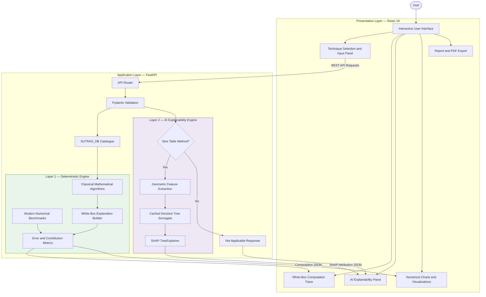
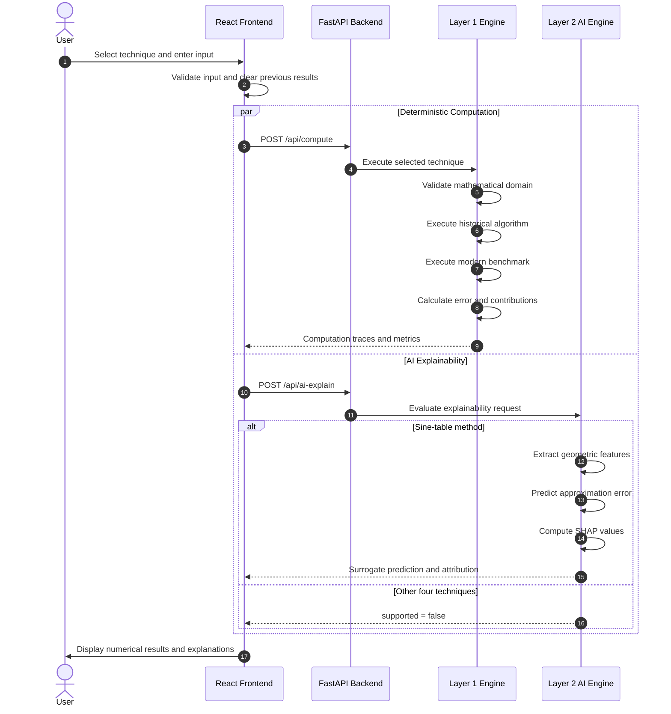
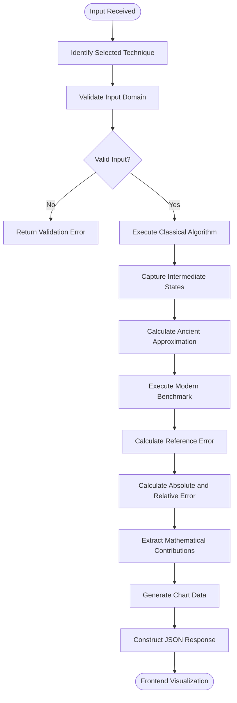
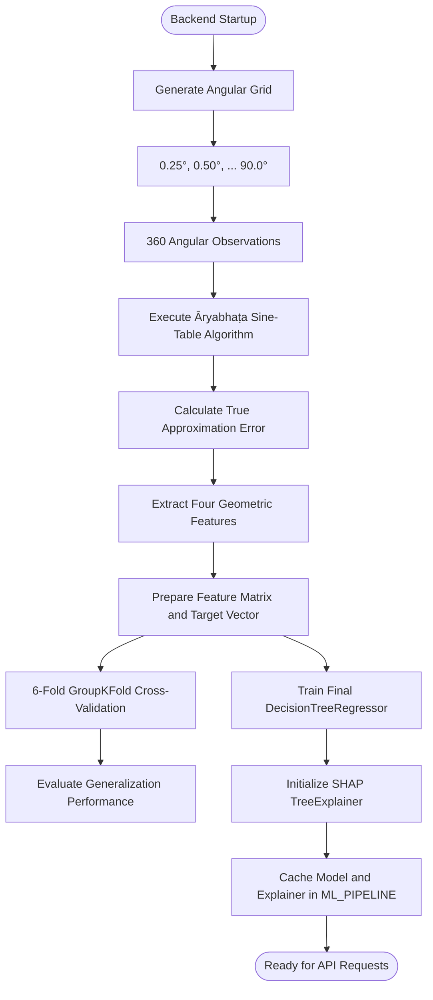
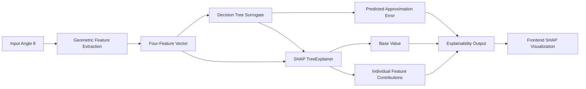

# Prism — Explainable AI Framework for Computational Modeling of Ancient Indian Mathematical Approximation Techniques

<p align="center">
  <strong>Bridging Classical Indian Mathematics and Modern Explainable Artificial Intelligence</strong>
</p>

<p align="center">
  
  
  
  
  
  
  
</p>
---

## 1. Overview

**Prism** is a full-stack computational modeling and Explainable Artificial Intelligence (XAI) framework that reconstructs, executes, and evaluates five classical Indian mathematical approximation techniques documented in the *Āryabhaṭīya* (499 CE) and *Līlāvatī* (1150 CE).

The framework investigates how historical mathematical procedures compare with modern numerical methods and IEEE-754 double-precision arithmetic.

Rather than treating historical algorithms as black boxes or indiscriminately applying machine learning explainers to deterministic mathematical computations, Prism introduces a **two-layer explainability architecture**:

- **Layer 1 — Deterministic White-Box Explainability:** Reconstructs and executes all five mathematical techniques using Python's `Decimal` arithmetic, exposing intermediate calculations, iterative states, remainders, and exact numerical contributions.
- **Layer 2 — AI-Assisted Error Attribution:** Uses a Decision Tree surrogate model and SHAP (SHapley Additive exPlanations) to explain the error behavior of the Āryabhaṭa sine-table approximation.

The architecture deliberately distinguishes between deterministic mathematical transparency and statistical model-based explainability.

### Key Objectives

1. Computationally reconstruct selected classical Indian mathematical approximation techniques.
2. Preserve the mathematical logic and intermediate steps of the historical procedures.
3. Benchmark classical approximations against modern numerical methods.
4. Quantify approximation errors using absolute and relative error metrics.
5. Apply machine learning to model the error behavior of the sine-table technique.
6. Use SHAP to identify and quantify the influence of individual geometric features on predicted error.
7. Present mathematical computations and explanations through an interactive web interface.

---

## 2. System Architecture

PRISM follows a modular full-stack architecture consisting of a React-based presentation layer, a FastAPI computational backend, and a dedicated machine learning explainability pipeline.

The frontend communicates with the backend through REST API endpoints. The computational engine and AI explainability engine operate independently, allowing deterministic numerical results to remain separate from statistical error attribution.

### 2.1 High-Level Architecture



### 2.2 Architectural Components

| Component             | Responsibility                                                                              |
| --------------------- | ------------------------------------------------------------------------------------------- |
| React Frontend        | User interaction, input validation, computation display and visualization                   |
| FastAPI Backend       | REST API routing, request validation and computational orchestration                        |
| SUTRAS_DB             | Central catalogue containing the five mathematical techniques and their historical metadata |
| Numerical Engine      | Executes reconstructed mathematical procedures                                              |
| Benchmark Engine      | Executes corresponding modern numerical methods                                             |
| White-Box XAI Engine  | Produces intermediate execution traces and mathematical contribution explanations           |
| ML Surrogate Pipeline | Learns the error behavior of the sine-table approximation                                   |
| SHAP Explainer        | Attributes surrogate predictions to individual input features                               |
| Visualization Layer   | Displays numerical comparisons, error plots and SHAP contributions                          |

---

## 3. Two-Layer Explainability Architecture

A central design decision in PRISM is that not every mathematical computation requires machine learning-based explainability.

For deterministic algorithms, the actual execution sequence provides a more direct and mathematically faithful explanation than applying a statistical explainer to the algorithm itself.

PRISM therefore separates explainability into two complementary layers.

### Layer 1: Deterministic White-Box Explainability

**Applicable to all five techniques.**

The numerical engine reconstructs each mathematical procedure and records its intermediate execution states.

Implementation characteristics:

- Python `Decimal` arithmetic for controlled numerical precision.
- Six-decimal-place truncation for the root extraction procedures.
- Explicit intermediate calculation and remainder tracking.
- Place-value contributions for square-root extraction.
- Term-wise contributions wherever applicable.
- Comparison against modern numerical benchmarks.
- Absolute and relative error computation.

The output is an execution trace that explains how the final approximation was obtained.

### Layer 2: AI-Assisted Error Attribution

**Applicable specifically to the Āryabhaṭa sine-table technique.**

A DecisionTreeRegressor surrogate is trained on a sampled angular grid to learn the error behavior of the sine-table approximation.

The trained model is subsequently explained using `shap.TreeExplainer`.

The explanation identifies how individual geometric features influence the surrogate's predicted approximation error.

For the other four techniques, the API returns an explicit `supported: false` response because their errors are fixed, negligible, or otherwise not appropriate for the implemented surrogate-based attribution pipeline.

### 3.1 Request Execution Workflow

The frontend sends two independent requests in parallel whenever a computation is initiated.



### 3.2 Layer 1 Execution Pipeline



### 3.3 Layer 2 Surrogate Training Pipeline

The surrogate model is trained once during backend initialization rather than being retrained for every user request.

The training process samples the first-quadrant angular domain at intervals of 0.25 degrees.

This produces 360 observations.



**Model configuration**

| Parameter                 | Configuration              |
| ------------------------- | -------------------------- |
| Model                     | DecisionTreeRegressor      |
| Maximum depth             | 4                          |
| Random state              | 42                         |
| Training observations     | 360                        |
| Angular sampling interval | 0.25°                      |
| Validation                | 6-fold GroupKFold          |
| Grouping variable         | interval_index             |
| Explainer                 | shap.TreeExplainer         |
| Initialization            | Backend startup            |
| Runtime behavior          | Cached model and explainer |

---

## 4. Implemented Mathematical Techniques

PRISM implements exactly five mathematical techniques from classical Indian mathematical literature.

The techniques are maintained in a centralized `SUTRAS_DB` catalogue.

| No. | Method ID             | Technique                         | Classification | Historical Source                                        |
| --- | --------------------- | --------------------------------- | -------------- | -------------------------------------------------------- |
| 1   | `aryabhata_sqrt`      | Āryabhaṭa Square Root (Vargamūla) | Dynamic        | Āryabhaṭīya, Gaṇitapāda Verse 4                          |
| 2   | `aryabhata_cuberoot`  | Āryabhaṭa Cube Root (Ghanamūla)   | Dynamic        | Āryabhaṭīya, Gaṇitapāda Verse 5                          |
| 3   | `aryabhata_sinetable` | Āryabhaṭa Sine Table (Jyā)        | Dynamic        | Āryabhaṭīya, Gaṇitapāda Verse 12 and Gītikāpāda Verse 12 |
| 4   | `aryabhata_pi`        | Āryabhaṭa Pi Approximation        | Static         | Āryabhaṭīya, Gaṇitapāda Verse 10                         |
| 5   | `bhaskara2_pi`        | Bhāskara II Pi Approximation      | Static         | Līlāvatī, Kṣetravyavahāra Verse 201                      |

### 4.1 Square Root — Āryabhaṭa

**Method ID:** `aryabhata_sqrt`

The implementation reconstructs the place-value-based square-root extraction procedure.

It processes the number using odd and even place-value positions and calculates the corresponding root contributions.

Example:

[
\sqrt{55225}=235
]

The reconstructed result is decomposed into:

| Contribution   |   Value | Percentage |
| -------------- | ------: | ---------: |
| Hundreds place |     200 |     85.11% |
| Tens place     |      30 |     12.77% |
| Units place    |       5 |      2.13% |
| **Total**      | **235** |   **100%** |

The algorithm uses scaled-integer operations with Python `Decimal` arithmetic and truncates the result to six decimal places.

### 4.2 Cube Root — Āryabhaṭa

**Method ID:** `aryabhata_cuberoot`

The cube-root procedure reconstructs the classical place-value-based extraction process.

Example:

[
\sqrt[3]{1771561}=121
]

The engine captures the intermediate extraction stages and compares the resulting approximation with a modern Newton–Raphson reference.

### 4.3 Sine Table — Āryabhaṭa

**Method ID:** `aryabhata_sinetable`

The sine approximation reconstructs the historical Jyā sine-table procedure.

Two historical computational elements are represented:

1. The recurrence procedure from Gaṇitapāda Verse 12.
2. The stored first-difference values from Gītikāpāda Verse 12.

The 24 first differences are stored in `GITIKAPADA_24_DIFFS`.

Key parameters:

| Parameter                    |           Value |
| ---------------------------- | --------------: |
| Reference radius (R)         | 3438 arcminutes |
| Angular interval (h)         |           3.75° |
| Angular interval             |  225 arcminutes |
| Number of stored differences |              24 |

**Important implementation distinction:**

The unrounded recurrence procedure exhibits cumulative drift relative to the stored historical table.

The observed differences reach approximately:

- 8.2 arcminutes at 45°.
- 62.6 arcminutes at 90°.

Therefore, PRISM calculates the primary sine approximation using the stored table and linear interpolation between adjacent nodes.

The recurrence is retained as a separate computational trace for historical comparison.

### 4.4 Pi — Āryabhaṭa

**Method ID:** `aryabhata_pi`

The implementation uses the classical approximation:

[
\pi \approx \frac{62832}{20000}=3.1416
]

This is treated as a static approximation.

Its output is compared with a modern Machin-formula-based numerical reference and IEEE-754 double-precision arithmetic.

### 4.5 Pi — Bhāskara II

**Method ID:** `bhaskara2_pi`

The implementation represents the approximation:

[
\pi \approx \frac{3927}{1250}=3.1416
]

The framework also displays the gross approximation:

[
\pi \approx \frac{22}{7}
]

An independent geometrical validation is performed using an inscribed 384-sided polygon.

For diameter:

[
D=1250
]

The computed polygon perimeter is approximately:

[
P\_{384}=3926.947
]

Therefore:

[
\frac{P\_{384}}{1250}\approx3.141558
]

This provides an independent geometrical comparison with the rational approximation.

---

## 5. Modern Numerical Benchmarking

Each classical technique is compared against a corresponding modern numerical method.

| Classical Technique | Modern Benchmark | Numerical Reference       |
| ------------------- | ---------------- | ------------------------- |
| Square Root         | Newton–Raphson   | IEEE-754 double precision |
| Cube Root           | Newton–Raphson   | IEEE-754 double precision |
| Sine Table          | Maclaurin Series | IEEE-754 double precision |
| Āryabhaṭa Pi        | Machin Formula   | IEEE-754 double precision |
| Bhāskara II Pi      | Machin Formula   | IEEE-754 double precision |

The framework evaluates numerical performance using:

**Absolute Error**

[
E\_{\text{abs}}=|x\_{\text{approx}}-x\_{\text{reference}}|
]

**Relative Error**

[
E\_{\text{rel}}=
\frac{|x\_{\text{approx}}-x\_{\text{reference}}|}
{|x\_{\text{reference}}|}
]

For values where the reference is zero, relative error requires separate handling.

### 5.1 Charting Strategy

PRISM uses different visualization strategies depending on the mathematical technique.

- **Iterative root extraction:** Displays logarithmic error decay using (\log\_{10}(|Estimate-Truth|)).
- **Sine-table approximation:** Displays normalized Rsine values at the 3.75° historical table nodes against the corresponding modern sine values.
- **Static pi approximations:** Displays the classical and modern numerical values alongside their approximation errors.

This separation ensures that visualizations represent the actual computational characteristics of each method.

---

## 6. Machine Learning and SHAP Explainability

### 6.1 Feature Engineering

The sine-table surrogate uses four geometric features to characterize the relationship between an angle and its approximation error.

| Feature                    | Description                                                      |
| -------------------------- | ---------------------------------------------------------------- |
| `theta`                    | Input angle in degrees                                           |
| `distance_to_nearest_node` | Angular distance from the closest historical sine-table node     |
| `position_in_interval`     | Relative position of the angle within its interpolation interval |
| `interval_index`           | Index of the corresponding sine-table interval                   |

The target variable is the absolute error between the reconstructed sine approximation and the true sine value.

[
y=|A(\theta)-\sin(\theta)|
]

Where:

- (A(\theta)) is the reconstructed sine-table approximation.
- (\sin(\theta)) is the modern reference value.

### 6.2 Model Validation

The model is evaluated using six-fold GroupKFold cross-validation, with observations grouped by `interval_index`.

Grouping by interval prevents observations from the same interpolation interval from being distributed arbitrarily across training and validation folds.

This provides a more meaningful assessment of generalization across different table intervals.

### 6.3 SHAP Attribution

SHAP explains how the surrogate model's predicted error changes relative to its expected output.

The additive explanation follows:

[
f(x)=E[f(X)]+\sum\_{i=1}^{n}\phi_i
]

Where:

- (f(x)) is the surrogate prediction.
- (E[f(X)]) is the expected model output.
- (\phi_i) is the SHAP contribution of feature (i).

PRISM uses `shap.TreeExplainer` to calculate the individual feature contributions.

### 6.4 Explainability Pipeline



---

## 7. Verified Numerical and Surrogate Metrics

The following results represent the project's recorded validation and benchmarking runs.

### 7.1 Layer 1 — Numerical Accuracy

| Technique      | Input   | Ancient Result | Modern Reference | Absolute Error |
| -------------- | ------- | -------------: | ---------------: | -------------: |
| Square Root    | 55225   |          235.0 |            235.0 |            0.0 |
| Square Root    | 2       |       1.414213 |         1.414214 |        5.60e-7 |
| Cube Root      | 1771561 |          121.0 |            121.0 |            0.0 |
| Cube Root      | 30      |       3.107232 |         3.107233 |        5.10e-7 |
| Sine Table     | 77°     |       0.973880 |         0.974370 |       4.899e-4 |
| Āryabhaṭa Pi   | Static  |         3.1416 |         3.141593 |        7.35e-6 |
| Bhāskara II Pi | Static  |         3.1416 |         3.141593 |        7.35e-6 |

**Additional validation:**

- 2,500 randomly generated root inputs were tested across the supported domain.
- Worst observed square-root and cube-root errors remained below (10^{-6}).

### 7.2 Layer 2 — Surrogate Model Performance

| Metric                   |            Result |
| ------------------------ | ----------------: |
| Training observations    |               360 |
| Cross-validation         | 6-fold GroupKFold |
| Cross-validated R²       |            0.8253 |
| Training R²              |            0.9028 |
| Expected SHAP base value |         1.9337e-4 |
| Model depth              |                 4 |

### 7.3 Global Feature Attribution

Across the 360-angle evaluation grid:

| Feature                    | Dominant Feature Count |
| -------------------------- | ---------------------: |
| `distance_to_nearest_node` |                    193 |
| `theta`                    |                    167 |
| `position_in_interval`     |           Not dominant |
| `interval_index`           |                      0 |

The `interval_index` feature receives zero attribution across the evaluated observations because of its redundancy with the angular feature in the fitted depth-limited tree.

### 7.4 Selected Local SHAP Results

| Angle | Node Distance | True Error | Predicted Error |
| ----- | ------------: | ---------: | --------------: |
| 40°   |         1.25° |  2.6289e-4 |       3.0558e-4 |
| 45°   |          0.0° |    9.63e-6 |        8.784e-5 |
| 30°   |          0.0° |        0.0 |        8.784e-5 |

These results demonstrate how the surrogate captures general error patterns while retaining prediction differences from the actual numerical computation.

**Interpretation:** The surrogate is an explanatory approximation of the error function, not a replacement for the deterministic mathematical engine. Its predictions should not be interpreted as exact numerical results.

---

## 8. API Reference

The backend exposes three primary REST API endpoints.

### 8.1 GET `/api/sutras`

Returns the complete five-technique catalogue.

**Response information includes:**

- Method identifiers.
- Technique names.
- Historical metadata.
- Sanskrit verses in Devanagari.
- IAST transliterations.
- English translations.
- Input guidelines and domain information.

Example:

```bash
curl http://localhost:8000/api/sutras
```

### 8.2 POST `/api/compute`

Executes Layer 1 deterministic computation.

**Request body:**

```json
{
  "method_id": "aryabhata_sqrt",
  "input_value": 55225
}
```

**Example request:**

```bash
curl -X POST http://localhost:8000/api/compute \
  -H "Content-Type: application/json" \
  -d '{"method_id": "aryabhata_sqrt", "input_value": 55225}'
```

**Processing includes:**

1. Request validation.
2. Classical algorithm execution.
3. Intermediate-state capture.
4. Modern numerical benchmarking.
5. Error computation.
6. Mathematical contribution analysis.
7. Chart-data generation.

The endpoint returns the computation result, intermediate traces, benchmark comparison, error metrics and visualization data.

### 8.3 POST `/api/ai-explain`

Executes Layer 2 machine learning-based error attribution.

**Request body:**

```json
{
  "method_id": "aryabhata_sinetable",
  "input_value": 40.0
}
```

**Example request:**

```bash
curl -X POST http://localhost:8000/api/ai-explain \
  -H "Content-Type: application/json" \
  -d '{"method_id": "aryabhata_sinetable", "input_value": 40.0}'
```

**For the sine-table method, the response includes:**

- Surrogate-predicted error.
- Actual numerical error.
- SHAP expected/base value.
- Individual feature contributions.
- Model performance information.

For other methods, the endpoint returns a structured unsupported/not-applicable response.

---

## 9. Technology Stack

| Layer                 | Technologies                                 |
| --------------------- | -------------------------------------------- |
| Frontend Framework    | React 19                                     |
| Frontend Build Tool   | Vite                                         |
| Styling               | Tailwind CSS 4                               |
| Charts                | Recharts                                     |
| Icons                 | Lucide React                                 |
| PDF Export            | html2pdf.js                                  |
| Backend Framework     | FastAPI                                      |
| API Validation        | Pydantic                                     |
| Backend Server        | Uvicorn                                      |
| Numerical Computation | Python Decimal, NumPy                        |
| Machine Learning      | scikit-learn                                 |
| Explainable AI        | SHAP                                         |
| Data Processing       | Pandas                                       |
| Numerical Precision   | IEEE-754 double precision and Python Decimal |

---

## 10. Project Structure

```text
PRISM/
│
├── backend/
│   │
│   ├── main.py
│   │   ├── FastAPI application
│   │   ├── SUTRAS_DB catalogue
│   │   ├── Classical mathematical algorithms
│   │   ├── Modern numerical benchmarks
│   │   ├── White-box explanation engine
│   │   ├── Error and contribution calculations
│   │   ├── Chart-data generation
│   │   └── /api/sutras and /api/compute
│   │
│   ├── ai_explain.py
│   │   ├── Sine-table error sampling
│   │   ├── Geometric feature extraction
│   │   ├── GroupKFold cross-validation
│   │   ├── DecisionTreeRegressor training
│   │   ├── SHAP TreeExplainer initialization
│   │   ├── Cached ML pipeline
│   │   └── /api/ai-explain
│   │
│   └── requirements.txt
│       └── Python dependencies
│
├── frontend/
│   │
│   ├── src/
│   │   ├── App.jsx
│   │   │   ├── Main application interface
│   │   │   ├── Technique selection
│   │   │   ├── Dual API request handling
│   │   │   ├── White-box computation panels
│   │   │   ├── SHAP explainability panels
│   │   │   ├── Numerical charts
│   │   │   └── Report export
│   │   │
│   │   ├── main.jsx
│   │   │   └── React application entry point
│   │   │
│   │   └── components/
│   │       └── Reusable interface components
│   │
│   ├── package.json
│   └── vite.config.js
│
└── README.md
```

---

## 11. Getting Started

Follow these instructions to run PRISM locally.

### 11.1 Prerequisites

Ensure the following software is installed:

| Requirement | Version                           |
| ----------- | --------------------------------- |
| Python      | 3.10 or above                     |
| Node.js     | 18 or above                       |
| npm         | Compatible with installed Node.js |
| Git         | Latest stable version recommended |

### 11.2 Clone the Repository

```bash
git clone <YOUR_REPOSITORY_URL>
cd 
```


### 11.3 Start the Backend

Navigate to the backend directory:

```bash
cd backend
```

Create a virtual environment:

```bash
python -m venv venv
```

Activate it on Windows:

```powershell
venv\Scripts\activate
```

On macOS/Linux:

```bash
source venv/bin/activate
```

Install dependencies:

```bash
pip install -r requirements.txt
```

Start the FastAPI server:

```bash
python main.py
```

The backend should be available at:

```text
http://localhost:8000
```

Interactive API documentation:

```text
http://localhost:8000/docs
```

The sine-table surrogate model and SHAP explainer are initialized and cached during backend startup.

### 11.4 Start the Frontend

Open another terminal and navigate to the frontend directory:

```bash
cd frontend
```

Install dependencies:

```bash
npm install
```

Start the Vite development server:

```bash
npm run dev
```

Open the local URL displayed in the terminal. The default Vite address is:

```text
http://localhost:5173
```

### 11.5 Application Execution

Once both servers are running:

1. Open the frontend in your browser.
2. Select one of the five mathematical techniques.
3. Enter a valid input value.
4. Initiate the computation.
5. Explore the historical execution trace.
6. Compare the classical approximation with its modern benchmark.
7. Examine numerical error metrics and visualizations.
8. For the sine-table technique, inspect the surrogate model's predictions and SHAP feature attributions.

---

<p align="center">
  <strong>Prism</strong>
  <br/>
  Making mathematical computation transparent, interpretable, and explainable.
</p>
